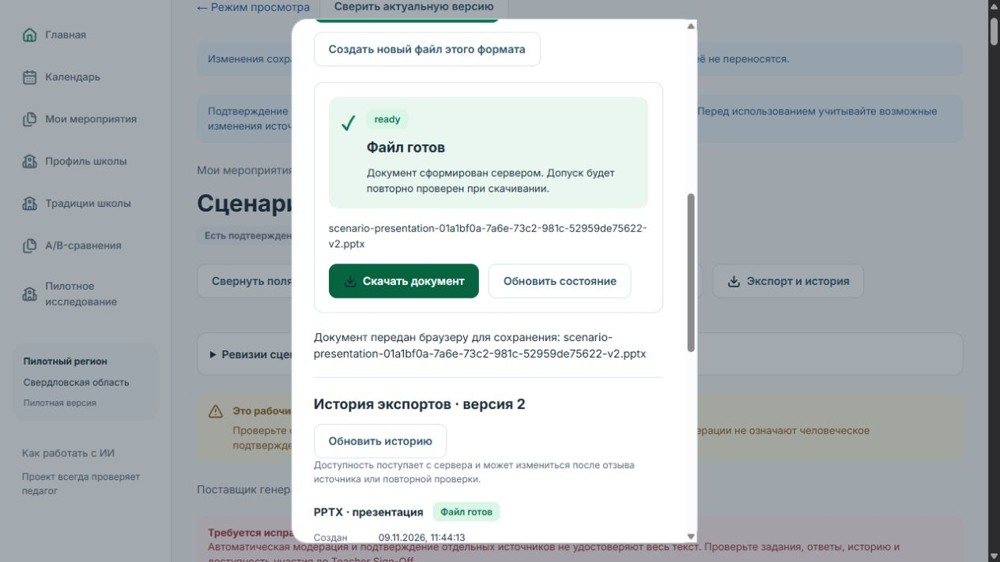
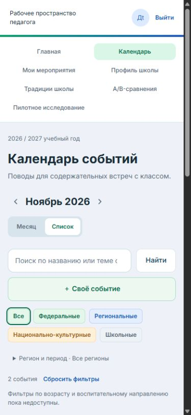
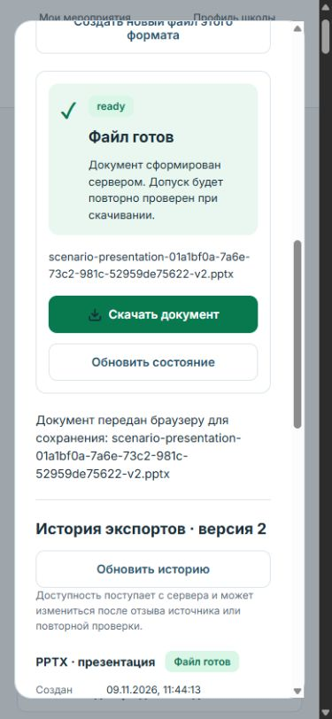

# DEPLOY-001.1 — Final Production Acceptance

**Статус: DEPLOY-001 CLOSED — PUBLIC HTTPS VERIFIED**

Дата проверки: 9 ноября 2026, 11:39–11:47 Asia/Yekaterinburg (06:39–06:47 UTC). Публичный адрес: <https://school-events.ru/>. Проверка выполнена с компьютера владельца по обычному DNS и HTTPS, без hosts override, SSH-туннеля и отключения TLS validation. Серверные проверки выполнены отдельно по SSH.

Блокирующих проблем не обнаружено. Код приложения, бизнес-логика и конфигурация production не изменялись; повторный deploy, рестарт стека и массовая регрессия не выполнялись. Создан один явно обозначенный синтетический запрос/сценарий и три экспорта. Существующие данные сохранены. HANDOFF-001 не запускался.

## Развёрнутые версии

- Backend: `ea1a51b634a0e5b3c4acea7360e3d19ff2256b73`.
- Frontend: `9aee989fb0cb040bb4855d7cfc11a612fecae396`.
- `current.env` на VPS подтверждает эту пару; образы имеют полные SHA tags в GitLab Container Registry.
- Последний deployment: [успешный GitLab job 17841892485](https://gitlab.com/Brossend2335/school-events-backend/-/jobs/17841892485), из DEPLOY-001. Новое развёртывание для приёмки не требовалось.

## DNS, сертификаты и перенаправления

| Проверка | Фактический результат |
| --- | --- |
| Родительская зона `.ru` | `a.dns.ripn.net` возвращает делегирование на `ns1.reg.ru`, `ns2.reg.ru` |
| Apex A через Cloudflare | `87.242.87.93` |
| www A через Google | `87.242.87.93` |
| AAAA apex/www | Записи не возвращаются; ошибочных IPv6 адресов нет |
| `https://school-events.ru/` | HTTP 200, проверка сертификата curl `ssl_verify_result=0` |
| `http://school-events.ru/` | 308 → `https://school-events.ru/` |
| `https://www.school-events.ru/` | 301 → `https://school-events.ru/`, TLS verification=0 |
| `http://www.school-events.ru/calendar` | 308 → `https://www.school-events.ru/calendar` |
| `https://www.school-events.ru/calendar` | 301 → `https://school-events.ru/calendar`; путь сохраняется |

Ответы содержат `Server: Caddy`. Сертификаты получены через SNI с `openssl s_client -verify_return_error`; обычный Windows curl дополнительно подтвердил доверие для обоих имён.

| Имя / SAN | Issuer | Начало UTC | Окончание UTC |
| --- | --- | --- | --- |
| `school-events.ru` | Let's Encrypt YE1 | 2026-11-08 12:28:42 | 2027-02-06 12:28:41 |
| `www.school-events.ru` | Let's Encrypt YE2 | 2026-11-08 12:28:39 | 2027-02-06 12:28:38 |

SHA-256 fingerprints:

```text
apex 09:50:BA:60:E2:A3:28:86:C8:25:A1:6D:8B:25:EC:55:52:92:E4:32:8E:E9:1C:95:B4:04:D3:C1:43:8D:EB:69
www  63:9F:A3:CA:44:91:23:09:67:8E:22:19:B5:49:EE:10:D0:8A:6A:FA:B6:48:0A:D4:92:A3:CA:E9:CF:CA:8B:E6
```

Предыдущий блокер делегирования/DNS устранён. Автоматическое будущее продление сертификатов ещё не наступало и этой проверкой не подтверждается.

## Nuxt, API, Sanctum и сессии

`/` открывает страницу входа для анонимного пользователя, после входа — рабочее пространство. Nuxt auth-страница содержит серверную форму; кабинет сохраняет существующее клиентское отображение. Полное SSR кабинета не заявляется.

Публичный `GET /api/v1/health` вернул 200:

```json
{"status":"ok","timestamp":"2026-11-09T06:39:46+00:00","services":{"database":"connected","redis":"connected"}}
```

Проверки выполнены через публичный HTTPS с проверкой TLS, без вывода cookie values и паролей:

- `GET /sanctum/csrf-cookie` → 204.
- Вход без X-XSRF-TOKEN → 419; вход с CSRF → 200.
- `schoolevents-session`: Secure, HttpOnly, SameSite=Lax.
- `XSRF-TOKEN`: Secure, SameSite=Lax; HttpOnly отсутствует, чтобы клиент мог сформировать CSRF header.
- Авторизованный `GET /api/v1/auth/me` → 200; после logout 204 тот же запрос → 401.
- В браузере педагог `teacher.alpha@demo.school-events.ru` вошёл обычной формой. Календарь, конструктор, генерация, сохранение и экспорт работали в одной сессии. Обновление страницы мобильного календаря сохранило авторизацию и данные.

## Основной маршрут в браузере по публичному адресу

Пройден настоящий интерфейс, без подмены браузерных действий прямыми API-вызовами:

1. Вход → главная → календарь ноября → «ДЕМО: день взаимопомощи» → конструктор.
2. Указаны 7–8 классы, 25 участников, классное мероприятие / классный час, 45 минут, взаимопомощь, бумага и проектор. Ограничения явно содержат `ДЕМО DEPLOY-001.1`, дату и синтетический характер проверки.
3. Сохранён ScenarioRequest `01a1bf0a-21c4-702b-a725-9b7251965afd`.
4. Через отдельное подтверждение запущена генерация `01a1bf0a-77a4-71ce-a069-546cb308c331`. Она завершена; UI явно сообщает MockLlmProvider и отсутствие внешней LLM. Read-only проверка БД: `completed|mock`.
5. Создан Scenario `01a1bf0a-7a6e-73c2-981c-52959de75622`, Revision 1. В интерфейсе доступны сценарий, материалы, источники и результат модерации.
6. В редакторе изменён замысел с явной пометкой технической приёмки; штатная кнопка сохранила Revision 2 (PATCH → 201). Выполнена проверка текущей ревизии: автоматическая модерация пройдена, P0=0, P1=0.
7. Тестовый Teacher Sign-Off принят сервером в `2026-11-09T06:43:13+00:00`. В заметках сохранено: `ДЕМО / TEST SIGN-OFF DEPLOY-001.1`, техническая проверка на синтетическом MockProvider-сценарии, не реальная педагогическая экспертиза и не разрешение проводить мероприятие.
8. Через диалог экспорта последовательно созданы PDF, DOCX, PPTX; worker завершил задания, каждый файл скачан кнопкой интерфейса через публичный HTTPS. История показывает все три готовых формата для Revision 2.

UI также показывает содержательные замечания Quality Gate (`Требуется исправление материала`, 11 замечаний) к шаблонному mock-контенту. Они не скрывались и не исправлялись изменением бизнес-логики. Технически успешная модерация и тестовый Sign-Off не означают педагогическую готовность этого демо-сценария.

### Доказательства экспортов

Скачанные файлы находятся в Downloads компьютера владельца. PDF проверен по `%PDF-` / `%%EOF`. DOCX/PPTX прошли ZIP integrity check, содержат `word/document.xml` / `ppt/presentation.xml`; PPTX содержит пять slides. SHA-256 каждого файла совпадает с `exported_artifacts.sha256_hash` на VPS (read-only SQL).

| Формат | Размер bytes | SHA-256 |
| --- | ---: | --- |
| PDF | 1297348 | `7c7ee23ddc845907d73dab2192f93f070e2d7a3772839d79047086f84fd80b19` |
| DOCX | 12045 | `5122c6f1fa8f165d6c8631af5240d4027b86d5d2796db8620dd057224221152a` |
| PPTX | 22289 | `a2b110c76622d9cce2e6e7dac5ab98715afdf9568436a46cab6eaa892f2185c6` |



## Мобильное отображение и ошибки

Проверен viewport 390×844: мобильная навигация, календарь (адаптивно выбирается список), диалог экспорта, готовый файл и история. Контент читаем, кнопки доступны; диалог имеет вертикальную прокрутку, горизонтального переполнения документа нет (`scrollWidth=375`, `innerWidth=390`, разница — scrollbar). Это проверка адаптивного browser viewport, не отдельный физический телефон. После проверки viewport возвращён к исходному размеру.

Browser console `error` / `warn` за проверенный маршрут: пустой список. В логах Nuxt за интервал проверки ошибок нет. По access log Nginx за интервал с 06:39:30 UTC до сверки после маршрута:

```text
200: 118; 201: 2; 202: 5; 204: 2; 401: 2; 419: 1
```

Единственные non-2xx API: начальный анонимный `/auth/me` → 401, намеренный вход без CSRF → 419, `/auth/me` после logout → 401. Неожиданных 4xx/5xx нет. Nginx сообщает buffering большого PDF во временный файл; скачивание завершено 200, checksum совпал, это не отказ API.





## Сервисы и ежедневный backup

На VPS запущены семь контейнеров `school-events-{app,worker,frontend,nginx,postgres,redis,proxy}-1`. Шесть сервисов с healthcheck имеют `healthy`; Caddy работает и обслуживает проверенный публичный HTTPS. Образы соответствуют SHA выше. PostgreSQL `pg_isready` принимает соединения, Redis отвечает `PONG`; публичный health подтверждает оба подключения.

Worker выполнил ExecuteGenerationRunJob, RunVerificationJob и три ExecuteExportJob. `failed_jobs=0`. У worker 18 рестартов за примерно 18 часов соответствуют настроенному `--max-time=3600` и `restart: unless-stopped`; проверены exit code 0 и OOMKilled=false. Другие контейнеры имеют 0 рестартов. Диск: около 9 GB занято, 20 GB свободно.

`school-backup.timer` enabled / active (waiting). Ежедневный запуск 9 ноября в **02:15 UTC / 07:15 Asia/Yekaterinburg** завершён `status=0/SUCCESS`. На VPS timezone MSK он отображается как 05:15. Создан `/opt/school-events/backups/20261109T021503Z`; проверка `sha256sum --check` дала OK для `database.dump`, `storage.tar.gz`, `release.env`. Следующий запуск: 10 ноября 02:15 UTC / 07:15 Asia/Yekaterinburg.

Восстановление backup в отдельную БД/volume уже проверялось в DEPLOY-001 (37 таблиц, 6 file checksums); здесь повторно не выполнялось. Бэкапы остаются на том же VPS; внешняя защищённая копия по-прежнему является эксплуатационным действием владельца. [Runbook](DEPLOY-001-runbook.md) содержит обновление, rollback и пути секретов.

## Итог

Публичный HTTPS, auth/session/CSRF, пользовательский маршрут до трёх скачанных экспортов, мобильное отображение, API, очереди и ежедневный backup подтверждены. `LLM_PROVIDER=mock`; внешняя LLM не вызывалась. DEPLOY-001 закрыт со статусом **DEPLOY-001 CLOSED — PUBLIC HTTPS VERIFIED**. Ограничения педагогического качества mock-материалов и внешнего хранения backup остаются явно обозначенными.
