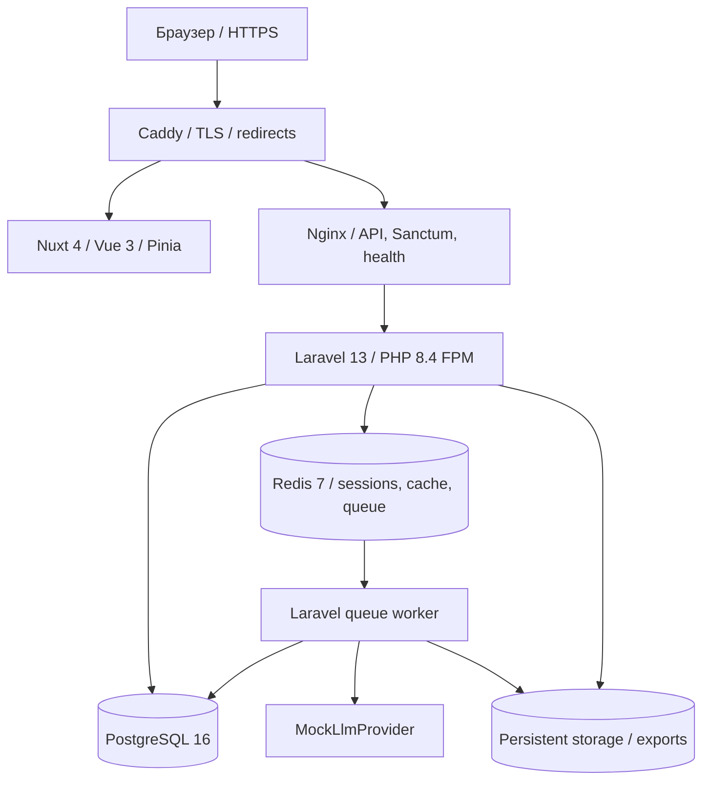

# HANDOFF-001 — фактическая архитектура

Публичный адрес: <https://school-events.ru/>. Один VPS `87.242.87.93`, Ubuntu 22.04.5, 2 CPU, около 4 GB RAM, 2 GB swap, диск 30 GB. Система — Laravel модульный монолит и отдельный Nuxt frontend.

Auth-страницы Nuxt используют SSR; кабинет — CSR, API plugin работает в браузере. Один origin: `/api/*`, `/sanctum/*`, health идут в Laravel; остальные страницы — в Nuxt. Sanctum: server-side Redis sessions, CSRF-cookie/header, Secure/HttpOnly session и SameSite=Lax. School membership и `X-School-Id` задают tenant context; политики проверяют роль/школу на сервере.

ScenarioRequest хранит исходные условия и snapshot. Redis worker асинхронно создаёт Scenario/Revision, выполняет проверку и собирает документы. Сохранение редактора создаёт новую ревизию с optimistic lock; Sign-Off и экспорт зависят от текущего состояния доказательств/fingerprint. Проверка источников и Quality Gate не заменяют педагогическую экспертизу.

`LlmProviderInterface` имеет Mock и реальный LiteLLM adapter. Production явно `LLM_PROVIDER=mock`; app/worker во внутренней сети без прямого internet egress. Отдельная [LLM-001.3](LLM-001.3-live-result.md) проверила реальную интеграцию в изолированном тестовом контуре. Она не означает включение реальной LLM на сайте.

## Docker и данные

Семь Compose services: app, worker, frontend, nginx, postgres, redis, proxy. Приватная сеть для приложения/БД/Redis, публичная — для Caddy. Наружу опубликованы 80/443 и административный SSH 22; loopback 8080 только для диагностики. PostgreSQL/Redis/FPM наружу не опубликованы. Persistent volumes: PostgreSQL, Redis AOF, Laravel storage, Caddy certificates/config. Есть health checks, restart policies, limits и ротация Docker logs. Worker timeout 840s, retry_after 900s, max-time 3600s; корректное завершение и restart штатны. Scheduler не нужен: scheduled задач приложения нет.

## CI/CD и обновление

GitLab primary → проверки → production images с полным commit SHA → manual protected-main deploy по отдельному SSH key с host verification → pull закреплённой пары → backup → migration → Compose health checks. `resource_group` и flock запрещают параллельный deploy. Frontend SHA закреплён в backend `docker/production/frontend-sha.txt`. Registry скачивается отдельными read_registry tokens; GitHub — только зеркало main. Полный env в CI не хранится.

Production: backend `ea1a51b634a0e5b3c4acea7360e3d19ff2256b73`, frontend `9aee989fb0cb040bb4855d7cfc11a612fecae396`. Manual deploy и повторный запуск доказаны [DEPLOY-001](DEPLOY-001-report.md), публичный маршрут — [DEPLOY-001.1](DEPLOY-001.1-final-acceptance.md).

## Backup, secrets и rollback

Ежедневно 02:15 UTC: pg_dump custom format + storage archive + release SHA + checksums. Восстановление в отдельную БД/volume проверено. 09.11.2026 одна AES-256-GCM копия snapshot `20261109T021503Z` перенесена на компьютер владельца, SHA и расшифрование проверены; детали в итоговом отчёте. Production APP_KEY/DB/registry/demo secrets хранятся root-only вне Git; в публичные материалы и backup release.env они не включены. DB dump содержит хеши паролей и поэтому зашифрован.

Rollback образов не откатывает схему БД. Для несовместимых migrations нужен отдельный план; zero downtime и автоматический rollback не заявляются. [Runbook](DEPLOY-001-runbook.md) содержит точные команды, пути и ограничения.
