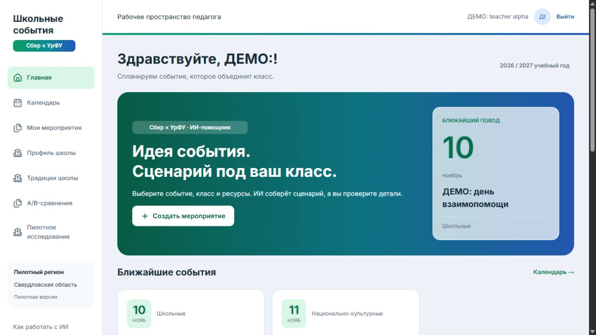
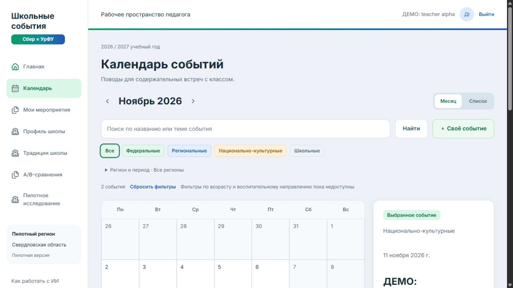
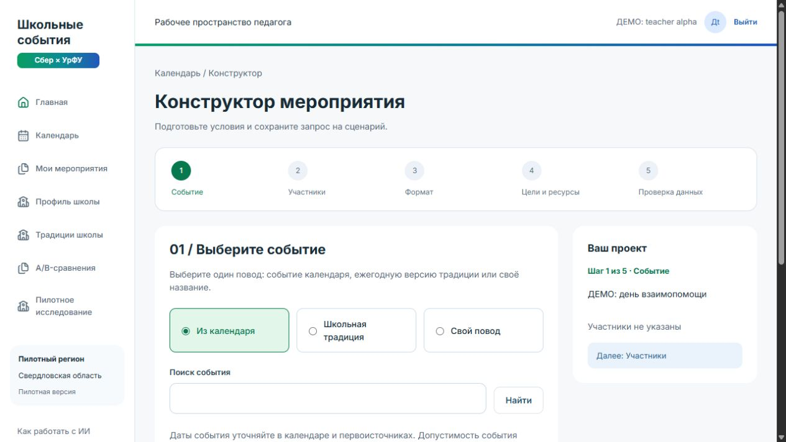
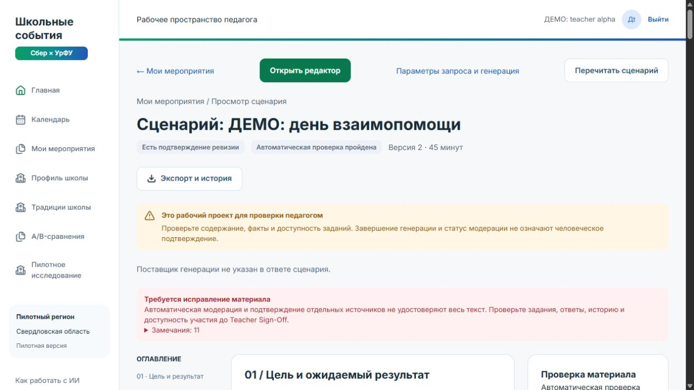
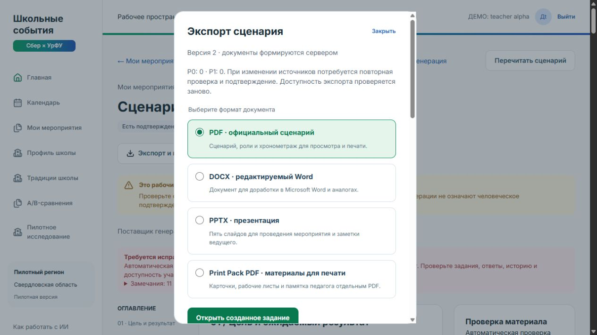
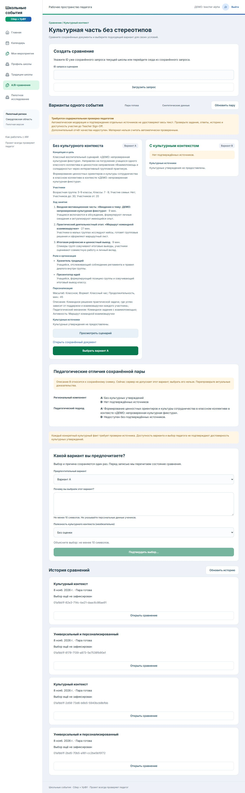

# HANDOFF-001 — демонстрация для проверяющего

Платформа: <https://school-events.ru/>. Пример рассчитан на 10–15 минут. Пароль владелец передаёт лично защищённым каналом, отдельно от этого документа. Аккаунт `teacher.alpha@demo.school-events.ru` — teacher только синтетической школы alpha, без системных/административных полномочий. Кнопку «Войти в деморежим» не использовать: серверный демовход не реализован.

## Подготовленный маршрут

| Шаг | Раздел и действие | Ожидаемый результат |
| --- | --- | --- |
| 1 | Обычная форма «Войти», приватно выданный аккаунт | Рабочее пространство педагога |
| 2 | Аватар → `/profile`, проверить школу | «ДЕМО: синтетическая школа alpha»; у аккаунта одно членство, выбор другой школы не требуется и недоступен |
| 3 | «Календарь», ноябрь 2026 | События «ДЕМО: день взаимопомощи» (10 ноября) и непроверенная культурная фикстура (11 ноября) |
| 4 | Выбрать день взаимопомощи → «Создать мероприятие» | Событие передано в конструктор |
| 5 | Пройти пять шагов | 7–8 классы, 25 человек, классное / классный час, 45 минут, взаимопомощь, бумага/проектор; ограничения явно пометить ДЕМО, синтетические данные |
| 6 | «Сохранить запрос» → «Запустить генерацию» → «Подтвердить запуск» | Запрос сохранён отдельно от запуска; страница состояния показывает completed и MockLlmProvider, внешняя LLM не вызывается |
| 7 | «Открыть сценарий» | Цели, подготовка, этапы, роли, материалы, источники и предупреждения качества |
| 8 | «Открыть редактор» → «Редактировать сценарий», изменить замысел → «Сохранить новую ревизию» | Новая ревизия, прежние проверки/подтверждения не считаются автоматически перенесёнными |
| 9 | Блок «Проверки и источники»; при необходимости «Повторить проверку» | Текущая модерация и P0/P1. При устаревшем fingerprint сначала повторить проверку; не обходить ограничения |
| 10 | «Подтверждение педагогом» | Только TEST SIGN-OFF: три пункта и заметка «ДЕМО / TEST: техническая демонстрация, не педагогическая экспертиза». Реальное проведение этим не одобряется |
| 11 | «Экспорт и история», выбрать по очереди PDF/DOCX/PPTX → «Создать экспорт» → дождаться ready → «Скачать документ» | Три серверных файла; история, формат, размер и версия отображены. Если допуск отозван — повторно проверить доказательства |
| 12 | «A/B-сравнения» → существующая история | Два варианта; в культурной паре без проверенных источников B недоступен. Исторический серверный отказ 409 зафиксирован в DEPLOY-001; не изменять источники ради показа |

HANDOFF использует готовые данные и не запускал новую генерацию. Если времени мало, шаги создания показывайте без отправки, затем откройте подготовленный сценарий и готовые экспорты. Если проверяющий выполняет запись сам, создаётся только его явно помеченный ДЕМО-запрос. Не вводите данные реальных детей.

## Готовые записи для воспроизводимой демонстрации

- [Сохранённый запрос](https://school-events.ru/scenario-requests/01a1bf0a-21c4-702b-a725-9b7251965afd).
- [Завершённый Mock run](https://school-events.ru/generation-runs/01a1bf0a-77a4-71ce-a069-546cb308c331).
- [Сценарий, версия 2](https://school-events.ru/scenarios/01a1bf0a-7a6e-73c2-981c-52959de75622).
- [Экспорт и история](https://school-events.ru/scenarios/01a1bf0a-7a6e-73c2-981c-52959de75622?export=1), три файла готовы.
- `/comparisons`: универсальная пара `01a1bb1f-8178-7139-a873-5e7538fb90e1`; культурная `01a1bb1f-82e3-714c-be21-daac6c86ae91`. Найти ID в истории и нажать «Открыть сравнение». Выбор фиксируется однократно; для просмотра его сохранять не нужно.

В HANDOFF культурная пара повторно открыта: B отсутствует среди доступных вариантов, UI объясняет отсутствие подтверждённых источников. Фикстуры намеренно не удостоверяются как этнографические факты. Показатели пилота не представлять результатами реального исследования.

## Скриншоты

Сняты с production 09.11.2026; только синтетические названия/имя педагога, без паролей, cookie, токенов и реальных персональных данных.

