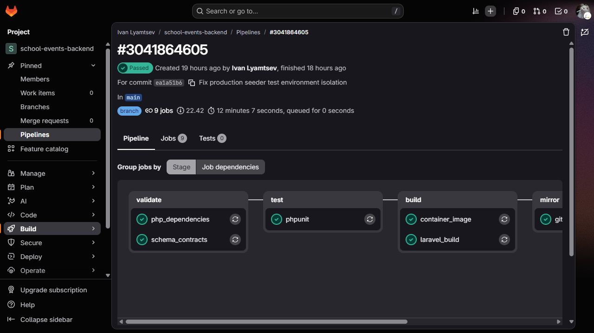
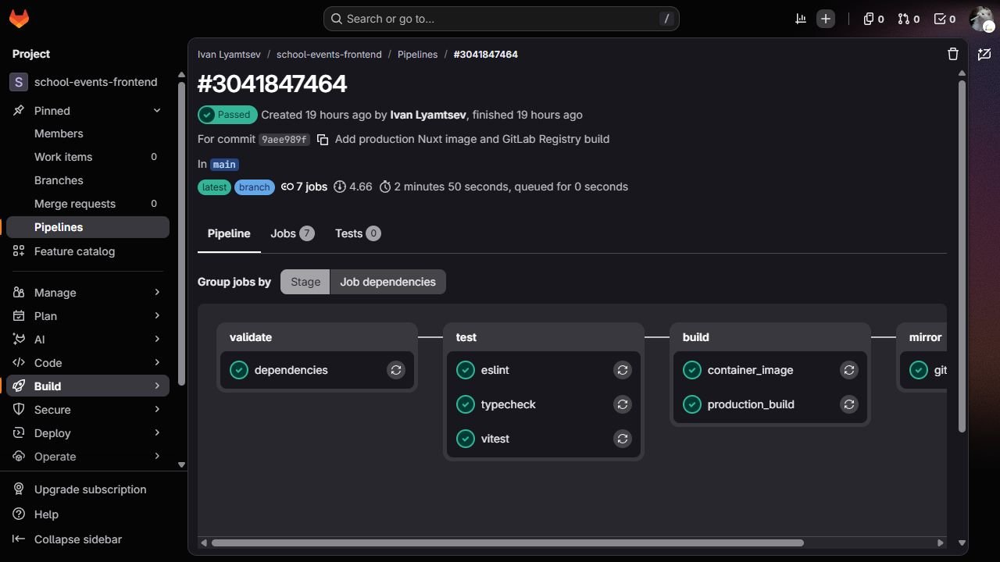

# HANDOFF-001 — FINAL DELIVERY REPORT

**Статус: HANDOFF-001 COMPLETE — READY FOR SUBMISSION**

Дата: 9 ноября 2026, Asia/Yekaterinburg. Технический комплект передачи подготовлен; ниже отдельно указаны действия, которые участники выполняют перед личной сдачей. DEPLOY-001 закрыт: **CLOSED — PUBLIC HTTPS VERIFIED**. Новые этапы разработки не запускались.

## Платформа, код и версии

- [Публичная платформа](https://school-events.ru/), [публичный health](https://school-events.ru/api/v1/health).
- Основные закрытые репозитории: [GitLab backend](https://gitlab.com/Brossend2335/school-events-backend), [GitLab frontend](https://gitlab.com/Brossend2335/school-events-frontend).
- Закрытые зеркала main: [GitHub backend](https://github.com/Brossend/school-events-backend), [GitHub frontend](https://github.com/Brossend/school-events-frontend).
- Production backend: `ea1a51b634a0e5b3c4acea7360e3d19ff2256b73`.
- Production frontend: `9aee989fb0cb040bb4855d7cfc11a612fecae396`.

Production SHA повторно прочитаны из `/opt/school-events/current.env`. HANDOFF меняет только документы/материалы: deployment и images не заменялись, private visibility не менялась. Коммиты документации могут быть новее deployed SHA.

## Передаваемый комплект

| Материал | Назначение |
| --- | --- |
| [Backend README](../README.md) / [Frontend README](https://gitlab.com/Brossend2335/school-events-frontend/-/blob/main/README.md) | Назначение, возможности, стек, краткий локальный запуск |
| [Демонстрационная инструкция](HANDOFF-001-demo-guide.md) | 12 шагов, названия элементов UI, ожидаемые результаты, ссылки на готовые записи |
| [Архитектура](HANDOFF-001-architecture.md) | Nuxt/Laravel/PostgreSQL/Redis/LLM/CI/CD, данные и backup |
| [Ограничения](HANDOFF-001-limitations.md) | Mock, отсутствие экспертизы и реального пилота, CSR, OS и эксплуатационные границы |
| [Текст для УрФУ ИМО](../УрФУ%20ИМО%20—%20Школьные%20события%20—%20промежуточные%20результаты.txt) | Первая строка строго «УрФУ ИМО», команда — явные поля для заполнения |
| [Скриншоты](evidence/HANDOFF-001/) | Главная, календарь, конструктор, сценарий, экспорт, культурный gate, оба CI pipelines |
| [Production runbook](DEPLOY-001-runbook.md) | Обновление через GitLab, rollback, backup, пути секретов |
| [DEPLOY-001.1 acceptance](DEPLOY-001.1-final-acceptance.md) | Основная доказательная база публичного HTTPS и полного маршрута |

Для передачи без доступа к private Git подготовлен локальный пакет `C:/Users/bross/.codex/handoff001-delivery/`: текст УрФУ, README, docs и скриншоты, ZIP с SHA-256. Это файлы для самостоятельной загрузки владельцем/участниками, не публичная публикация. В пакет включены только явно перечисленные документы и изображения; credentials, env, ключи и backup исключены.

## Актуальность и доказательства

09.11.2026 в HANDOFF повторно проверены:

- HTTPS главной → 200, стандартная TLS verification → 0; health → `ok`, PostgreSQL/Redis → `connected`.
- Существующая браузерная сессия педагога, главная, календарь, конструктор, готовый сценарий Revision 2 и три готовых экспорта. Повторно открыта культурная A/B-пара: B недоступен, интерфейс объясняет отсутствие подтверждённых источников. Новых запросов/сценариев/экспортов не создавалось, выбор A/B не фиксировался.
- Пять синтетических аккаунтов active: admin/system_admin; director.alpha и director.beta/school_admin своих школ; teacher.alpha и teacher.beta/teacher своих школ, system_role=none. Read-only проверка БД подтвердила роли и членства.
- Оба production pipelines в GitLab по указанным SHA — Passed: [backend 3041864605](https://gitlab.com/Brossend2335/school-events-backend/-/pipelines/3041864605), [frontend 3041847464](https://gitlab.com/Brossend2335/school-events-frontend/-/pipelines/3041847464). Backend deploy stage Passed; [повторный deploy job 17841892485](https://gitlab.com/Brossend2335/school-events-backend/-/jobs/17841892485). Jobs не перезапускались.
- Ежедневный backup service: Result=success, ExecMainStatus=0. Скопирован фактический snapshot `20261109T021503Z`.

В DEPLOY-001.1 уже проверены Sanctum, CSRF, Secure/HttpOnly/SameSite cookies, logout invalidation, публичный browser workflow до трёх скачанных файлов, SHA-256 экспортов, мобильный viewport и отсутствие неожиданных JS/API ошибок. В DEPLOY-001 проверены persistence после рестарта, isolated restore 37 таблиц/6 файлов и повторный CI deploy. В HANDOFF полная регрессия и эти мутации не повторялись.

Исторические доказательства: [публичная приёмка](DEPLOY-001.1-final-acceptance.md), [серверное развёртывание](DEPLOY-001-report.md), [отдельный LiteLLM live test](LLM-001.3-live-result.md). Ранние FE/LLM отчёты описывают состояние своих этапов, их pending review не заменяет свежую техническую приёмку и не означает проведённую педагогическую экспертизу.




## Безопасная передача demo-доступа

Проверяющему предназначен существующий `teacher.alpha@demo.school-events.ru`, teacher одной синтетической школы. Административные credentials в handoff-пакет не включены. Владелец получает локальный файл **вне репозиториев**:

`C:/Users/bross/.codex/handoff001-private/demo-access.txt`

Windows ACL: наследование отключено, доступ выдан текущему пользователю владельца. Значение пароля не выводилось в чат и не включалось в Git. Передавать этот файл/пароль проверяющему только приватным согласованным каналом, отдельно от общего TXT/ZIP; действие отправки исполнителем не выполнялось. Назначение и ограничения аккаунта описаны в [demo guide](HANDOFF-001-demo-guide.md).

## Проверенная внешняя зашифрованная копия

По явному разрешению владельца snapshot `/opt/school-events/backups/20261109T021503Z` перенесён по SSH на его компьютер. Проверены SHA-256 файлов database.dump, storage.tar.gz и release.env по исходному checksums.sha256, затем архив зашифрован AES-256-GCM (random key 256 bit, nonce 96 bit). Расшифрование прочитанной с диска копии и SHA-256 исходного tar совпали. Незашифрованный tar при переносе на диск не записывался.

- Архив: `C:/Users/bross/.codex/backups/school-events/20261109T021503Z.tar.aesgcm`.
- Размер: **2539554 bytes**.
- SHA-256 зашифрованной копии: `da2f924b0c7a23141b87dc8569fb7632979a6509aac401f55c3b5f5ba2e6a5e9`.
- SHA-256 исходного tar: `270d333202ffb9c30d5f8a3d0deb247088060d4892a9590ab44b86d455f29cbd`.
- Ключ отдельно: `C:/Users/bross/.codex/backup-keys/school-events/20261109T021503Z.key`.
- Manifest: рядом с архивом, `20261109T021503Z.manifest.json`; helper `decrypt-backup.py` позволяет владельцу проверить и расшифровать архив в новый файл без перезаписи.
- Каталоги архива/ключа имеют отключённое наследование ACL и доступ текущего пользователя Windows. Ключ не включён в архив и Git.

Команда владельца (создаёт новый plaintext tar в защищённом каталоге, не восстанавливает рабочую БД):

```powershell
python C:/Users/bross/.codex/backups/school-events/decrypt-backup.py
```

Это одна согласованная внешняя копия, а не настроенная автоматическая репликация. Snapshot предшествует публичной приёмке 09.11 в 06:39 UTC; более поздние записи в него не входят. APP_KEY/env отсутствуют в архиве и сохраняются отдельно владельцем. Ключ в другом каталоге того же компьютера — владельцу нужна отдельная защищённая копия ключа на случай потери компьютера. Рабочая БД и volumes не заменялись.

## Действия участников перед личной сдачей

1. Заполнить точные ФИО и роли команды в TXT; состав не выдуман.
2. Каждый участник самостоятельно загружает текстовый файл в свой личный кабинет УрФУ ИМО и проверяет доступ для проверяющего. Исполнитель не входил в кабинет и не подтверждает загрузку/права там.
3. Передать проверяющему demo-доступ приватно. При необходимости предоставить доступ к private Git или приложить разрешённый локальный пакет документов/скриншотов; репозитории публичными не делать.
4. Сохранить отдельную защищённую копию backup key; далее организовать регулярный внешний backup и контроль свободного места.

Технических блокеров передачи нет. Педагогическая экспертиза, полноценный пилот и содержательная доработка mock-сценариев остаются за границами завершённой технической поставки. Полный список — [limitations](HANDOFF-001-limitations.md).
