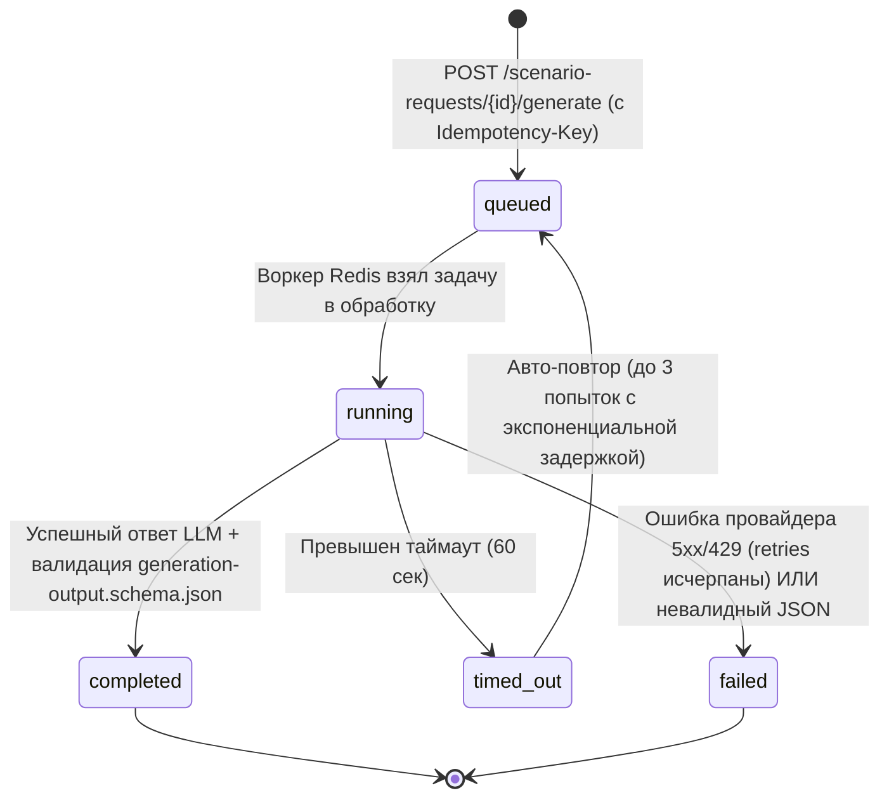
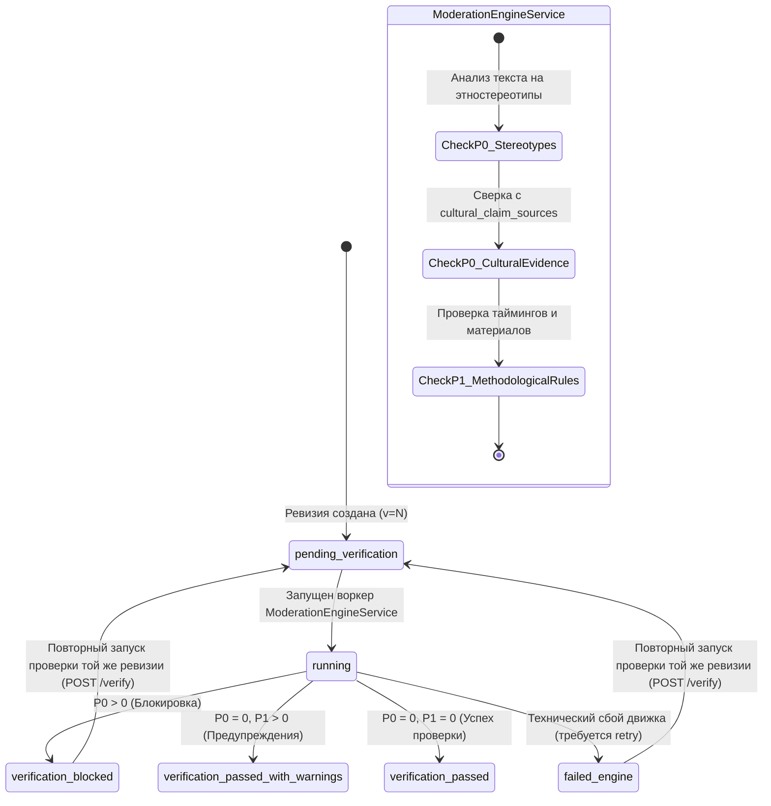
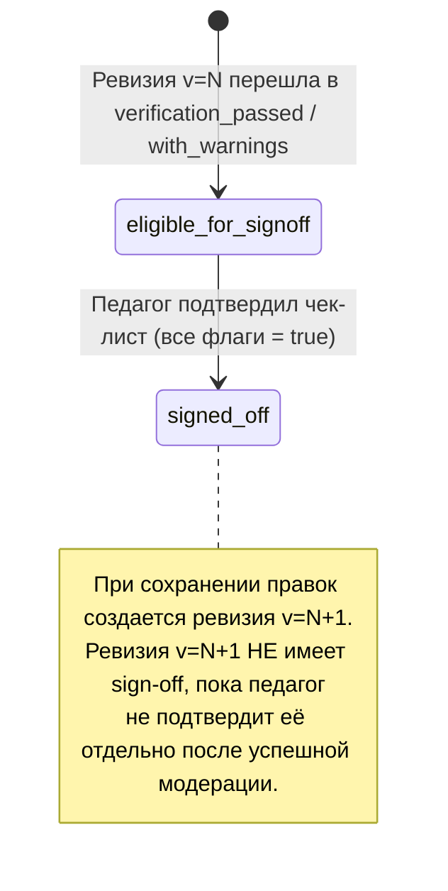

# Жизненные циклы и безопасность (Lifecycle & Security)

**Версия:** 1.2 (Фаза 0: Final Contract Fixes)  
**Проект:** «Школьные события» (Сбер × УрФУ)  
**Статус:** Hardened Contract Final (Архитектурное проектирование)

---

## 1. Десять обязательных правил безопасности и модерации

Система обязана программно обеспечивать соблюдение следующих 10 принципов:

1. **Непроверенный черновик после генерации:** Сразу после ответа LLM созданная ревизия сценария переходит в состояние `pending_verification`. Она доступна автору для предварительного чтения только с пометкой «Не проверено модерацией». Система категорически запрещает маркировать её как готовый или безопасный материал.
2. **Запрет sign-off и экспорта до завершения проверки:** Пока статус модерации ревизии находится в `pending_verification` или `running`, эндпоинты `POST /signoff` и `POST /exports` возвращают ошибку `422 Unprocessable Content` / `403 Forbidden`.
3. **Отказ движка — не успех проверки (`failed_engine`):** Любой технический сбой `ModerationEngineService` (таймаут, падение воркера, недоступность БД) переводит ревизию в состояние `failed_engine`. Это состояние **ни при каких условиях** не приравнивается к успешной проверке.
4. **Безусловная P0-блокировка:** Обнаружение хотя бы одного нарушения с уровнем критичности **P0** (этнические/расовые стереотипы, неподтверждённые культурные традиции, угроза безопасности детей) переводит ревизию в `verification_blocked`. Выдача сценария как готового и его скачивание блокируются.
5. **Создание нового `verification_run` при перепроверке:** Каждая автоматическая или ручная повторная проверка порождает отдельную неизменяемую запись в `verification_runs` с новым аудируемым набором `verification_findings`.
6. **Запрет трансферности проверок между ревизиями:** Результаты верификации ревизии $N$ принадлежат исключительно ревизии $N$. Их нельзя скопировать или зачесть для ревизии $N+1$, даже если в новой ревизии изменена всего одна фраза.
7. **Автопроверка ≠ абсолютная гарантия:** Автоматическая проверка проверяет отсутствие известных паттернов нарушений и сверяет источники по каталогу, но не заменяет педагогическую экспертизу. Система явно сообщает педагогу о необходимости личного методического контроля.
8. **Независимость проверки текста и источников:** Проверка текста на стереотипы (`P0_STEREOTYPE`) и проверка этнокультурных утверждений по таблице `cultural_claim_sources` (`P0_FABRICATED_CULTURE`) выполняются независимыми правилами. Одобрение одного правила не компенсирует провал другого.
9. **Ненаследование подтверждения (Sign-off Currency):** При создании новой ревизии прошлое подтверждение педагога остаётся привязано к старой ревизии в журнале `teacher_signoffs`, но **не наследуется** новой ревизией. Новая ревизия создаётся без sign-off.
10. **Тройная валидация перед экспортом:** Сервис экспорта проверяет: (а) принадлежность сценария текущей школе (`TenantContext`), (б) наличие актуального подтверждения педагога (`teacher_signoffs`) для текущей ревизии и отсутствие P0, (в) физическое существование скомпилированного файла на диске с валидным `sha256_hash`.

---

## 2. Диаграммы состояний (State Machines)

### 2.1. Генерация сценария (`generation_runs`)

### 2.2. Состояние модерации ревизии (`revision_moderation_states`)

Обратите внимание: статус `signed_off` **полностью исключён** из конечного автомата модерации ревизии. Модерация оценивает исключительно соответствие методическим правилам и первоисточникам. Личный Sign-off педагога — это независимый юридический факт, регистрируемый в таблице `teacher_signoffs`.

*Важное правило неизменяемости:* Если ревизия $N$ была заблокирована (`verification_blocked`), она **навсегда остаётся заблокированной в истории**. Создание исправленной ревизии $N+1$ не меняет статус ревизии $N$; для ревизии $N+1$ создаётся своя собственная запись в `revision_moderation_states` со статусом `pending_verification`.

### 2.3. Жизненный цикл человеческого подтверждения (`teacher_signoffs`)

---

## 3. Матрица разрешенных переходов состояний

| Сущность | Исходный статус | Целевой статус | Guard Condition (Условие) | Инициатор | Побочные эффекты (Side Effects) |
|---|---|---|---|---|---|
| `GenerationRun` | `queued` | `running` | Свободный воркер Redis | Фоновый воркер | Таймстамп старта, инкремент `attempts` |
| `GenerationRun` | `running` | `completed` | Ответ получен и валиден по `generation-output.schema.json` | `LlmOrchestrator` | Атомарное создание `scenario_revisions` (v=N), создание `revision_moderation_states` (`pending_verification`), диспатч `RunVerificationJob` |
| `GenerationRun` | `running` | `failed` | Ошибка провайдера после 3 попыток или сбой схемы | `LlmOrchestrator` | Санитизация текста ошибки в `generation_runs`, освобождение блокировки идемпотентности |
| `RevisionModerationState` | `pending_verification` | `running` | Запуск задачи модерации | `RunVerificationJob` | Фиксация таймстампа в `verification_runs` |
| `RevisionModerationState` | `running` | `verification_blocked` | Найдено $\ge 1$ нарушение P0 | `ModerationEngine` | Формирование `verification_findings`, блокировка Sign-Off и экспорта |
| `RevisionModerationState` | `running` | `verification_passed_with_warnings` | Нарушений P0 = 0, найдено $\ge 1$ предупреждение P1 | `ModerationEngine` | Разрешение Sign-Off с показом предупреждений |
| `RevisionModerationState` | `running` | `verification_passed` | Нарушений P0 = 0, нарушений P1 = 0 | `ModerationEngine` | Разрешение Sign-Off без замечаний |
| `RevisionModerationState` | `running` | `failed_engine` | Непредвиденный сбой проверки | Воркер модерации | Логирование ошибки движка, запрет перехода в `passed` |
| `RevisionModerationState` | `verification_blocked` / `failed_engine` | `pending_verification` | Вызов `POST /revisions/{v}/verify` для той же ревизии | Автор / Куратор | Создание новой строки в `verification_runs`, перевод статуса в `pending_verification` |
| `TeacherSignoff` | Отсутствует | Создан (`is_confirmed = true`) | `p0_violations_count == 0`, статус ревизии `passed` или `with_warnings`, все пункты чек-листа = `true` | Педагог школы | Фиксация IP и времени в `teacher_signoffs`, разблокировка экспорта |
| `Scenario` | `optimistic_lock_version = V` | `optimistic_lock_version = V + 1` | Заголовок `If-Match == V` и `version == current_revision.version_number` | Педагог / LLM | Атомарное создание `scenario_revisions` (v=N+1), переключение `current_revision_id` на N+1 |
| `ExportJob` | `queued` | `processing` | Ревизия имеет подтверждённый sign-off, P0 = 0 | Воркер экспорта | Генерация PDF по Blade-шаблону |
| `ExportJob` | `processing` | `ready` | Файл успешно записан на приватный диск | Воркер экспорта | Создание `exported_artifacts`, вычисление SHA-256 |

---

## 4. Конкурентные операции и предотвращение Race Conditions

### 4.1. Гонка между фоновой генерацией LLM и ручными правками пользователя
- При завершении `ExecuteGenerationRunJob` воркер захватывает атомарный распределенный замок Redis:
  `Cache::lock("scenario_mutation:{$scenarioId}", 10)->block(5)`
- Внутри транзакции выполняется:
  `$scenario = Scenario::where('id', $scenarioId)->lockForUpdate()->firstOrFail();`
- Если пользователь успел отредактировать сценарий вручную (версия `optimistic_lock_version` увеличилась), сгенерированная ревизия не перезаписывает текущую актуальную ревизию: она сохраняется в базу как параллельная ревизия с уведомлением автора о необходимости объединения или выбора версии.

### 4.2. Атомарность создания ревизий и защита от дублей версий
- Номер новой ревизии вычисляется строго внутри транзакции под защитой `lockForUpdate`:
  `$nextVersion = $scenario->revisions()->max('version_number') + 1;`
- Наличие ограничения `UNIQUE (scenario_id, version_number)` гарантирует, что даже при аппаратном сбое блокировки создание двух ревизий с одинаковым номером будет отклонено СУБД.

### 4.3. Актуальность Sign-Off и экспорт
- **Экспорт только актуальной ревизии (Early MVP Rule):** Для раннего MVP параметр `allow_historical=true` **строго запрещён**. Экспортировать разрешается исключительно актуальную подписанную ревизию (`is_current = true`, `version == current_revision.version_number`). Запрос на экспорт устаревшей ревизии отклоняется с кодом `409 Conflict` (`HISTORICAL_EXPORT_FORBIDDEN`).
- **Обязательный Idempotency-Key для асинхронного экспорта:** Эндпоинт запуска компиляции экспорта `POST /api/v1/scenarios/{id}/export` требует передачи обязательного клиентского заголовка `Idempotency-Key` (UUIDv4/v7). Запросы без заголовка отклоняются с кодом `400 Bad Request` (`IDEMPOTENCY_KEY_REQUIRED`). При повторном запросе с тем же ключом возвращается статус уже существующей фоновой задачи `export_jobs` без повторного запуска воркера.
- **Сохранение истории модерации при повторных запусках:** При повторном вызове модерации (`POST /revisions/{v}/verify`) создаётся новая строка в `verification_runs`. Прежние запуски и найденные нарушения `verification_findings` сохраняются в БД навсегда (Append-only аудит-лог). В таблице `revision_moderation_states` обновляется ссылка `latest_verification_run_id` и статус проверки.
